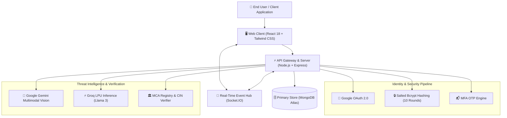

# TrustMatrix (CyberShield AI)

<p align="center">
  <strong>Autonomous Multi-Modal Threat Intelligence & Fraud Prevention Platform</strong>
  <br />
  Defending job seekers and digital workers against task scams, fraudulent employment offers, and financial cybercrime.
</p>

<p align="center">
  
  
  
  
  
  
</p>

---

## 👥 Engineering Team — DAXDEV

| Member | Role & Responsibilities | Active Branch |
| :--- | :--- | :--- |
| **Prabhat** | **Project Lead & Backend Architecture** (Express.js, MongoDB Atlas, Groq & Gemini Multimodal AI) | [`feat/backend`](https://github.com/Prabhat-d/Task-Scam-Fake-Job-detector/tree/feat/backend) |
| **Amandeep** | **Frontend Architecture & UI/UX** (React 18, Tailwind CSS, Interactive Cartogram & WebSockets) | [`feat/frontend`](https://github.com/Prabhat-d/Task-Scam-Fake-Job-detector/tree/feat/frontend) |
| **Pushkar** | **API Verification & Integration** (MCA Registry Validation, Forensic Analyzers & External APIs) | [`feat/verification`](https://github.com/Prabhat-d/Task-Scam-Fake-Job-detector/tree/feat/verification) |
| **Yuvraj** | **Data Engineering, QA & Presentation** (Datasets, Threat Ledger, Heuristic Testing & QA) | [`feat/data-qa`](https://github.com/Prabhat-d/Task-Scam-Fake-Job-detector/tree/feat/data-qa) |

---

## 📌 Executive Overview

**TrustMatrix** is a comprehensive cybersecurity and threat intelligence platform engineered to detect, deconstruct, and neutralize modern cyber employment scams. Combining multi-modal AI heuristics, official regulatory verification, and real-time forensic entity extraction, TrustMatrix protects users from sophisticated social engineering campaigns—ranging from fake freelance task scams on Telegram and WhatsApp to forged corporate appointment letters.

The system empowers both end users and law enforcement agencies by translating complex forensic signals into plain language, generating court-ready cybercrime incident dossiers, and maintaining an active threat intelligence ledger.

---

## 🛡️ Key Capabilities & Features

### 1. Multi-Modal Forensic AI Analysis
* **Document & Image Inspection**: Ingests offer letters (PDF, DOCX) and communication screenshots (PNG, JPG) using Google Gemini 1.5 Flash Vision & Groq LPU (Llama 3 70B/8B).
* **Heuristic Stage Classification**: Identifies scam lifecycle progression across 6 distinct phases:
  1. *Unsolicited Contact* (Cold messaging on WhatsApp/Telegram)
  2. *Low-Barrier Task* (YouTube likes, Google review submissions)
  3. *Micro-Payout Bait* (Small initial transfer to establish trust)
  4. *VIP Upgrade / Prepaid Merchant Task* (Escalation to high-value deposits)
  5. *Account Freeze & Bogus Penalty* (Fabricated operational errors)
  6. *Extortion & Financial Exfiltration* (Demands for release fees/taxes)
* **Confidence Scoring**: Delivers fine-grained confidence percentages, threat indicators, and predictive warnings detailing the attacker's expected next maneuver.

### 2. Corporate & Identity Verification
* **MCA Database Validation**: Cross-checks claimed employer entities against genuine 21-digit Corporate Identification Numbers (CIN) from the Ministry of Corporate Affairs registry.
* **Domain & Mail Server Forensics**: Flags impersonation patterns, such as recruitment solicitations claiming to represent multinational corporations originating from free webmail domains (`@gmail.com`, `@yahoo.com`) or typo-squatted domains.
* **Financial & Communication Entity Extraction**: Automatically isolates and catalogues UPI handles, contact numbers, cryptocurrency wallets, phishing URLs, and Telegram channels.

### 3. Real-Time Threat Monitoring & Cartogram
* **National Threat Heatmap**: Interactive, equalized tile-grid cartogram visualizing scam density, active attack waves, and regional target patterns across Indian States and Union Territories.
* **Live Telemetry Feed**: Real-time websocket streaming of verified threat detections, average financial loss metrics, and active attack indicators.

### 4. Live Session Interceptor & Simulation
* **Real-Time Chat Interception**: Socket.IO-powered chat monitor analyzing conversational trajectories in real time.
* **Instant Risk Escalation Alerts**: Triggers real-time audio and visual warnings as soon as an adversary introduces high-risk financial triggers.

### 5. Automated 1930 Cybercrime Dossier Export
* **Evidence Packaging**: Aggregates raw text, extracted indicators of compromise (IoCs), timestamps, and forensic highlights into a structured incident report.
* **One-Click PDF Generation**: Generates compliant documentation pre-formatted for direct submission to the National Cyber Crime Reporting Portal (`cybercrime.gov.in`) and the **1930** Citizen Financial Cyber Fraud Reporting Helpline.

### 6. Enterprise Identity & Access Management
* **Google OAuth 2.0 Integration**: Official, permission-gated single sign-on powered by `@react-oauth/google`.
* **Multi-Factor Authentication (MFA)**: Cryptographic 6-digit email OTP challenge pipeline.
* **Salted Password Encryption**: Industrial-strength `bcryptjs` hashing (10 salt rounds) with zero plain-text credential persistence.
* **Role-Based Access Control (RBAC)**: Segregated permissions for standard authenticated users and system administrators.

### 7. Trilingual Accessibility & Audio Explanations
* **Localization**: Seamless on-the-fly language switching across **English**, **Hindi (हिंदी)**, and **Punjabi (ਪੰਜਾਬੀ)**.
* **Speech Synthesis**: Native Text-to-Speech playback delivering verdict breakdowns in the user's preferred language.

---

## 🏗️ System Architecture



---

## 💻 Tech Stack

| Domain | Technologies |
| :--- | :--- |
| **Frontend Architecture** | React 18, Vite, React Router v6, Tailwind CSS v3, Zustand, Axios |
| **Real-Time Communication** | Socket.IO Client, WebSockets |
| **Data Visualization** | Recharts, Custom India SVG Cartogram |
| **Internationalization** | `react-i18next` (English, Hindi, Punjabi) |
| **Backend & Services** | Node.js, Express.js, Multer (multipart file ingestion) |
| **Database & Cache** | MongoDB Atlas (Mongoose ODM) |
| **AI & NLP Inference** | Google Gemini API (Multimodal), Groq API (High-speed LPU) |
| **Authentication & Security** | Google OAuth 2.0, Bcrypt.js (Salted Hashing), Time-gated OTP Engine |
| **Reporting & Export** | `jspdf`, `html2canvas` (Compliant Cybercrime Dossier Generation) |

---

## 🚀 Getting Started

### Prerequisites
* **Node.js**: v18.x or higher
* **npm**: v9.x or higher
* **MongoDB**: A running MongoDB instance or MongoDB Atlas connection string
* **API Keys** (optional for enhanced AI inference):
  * Google Gemini API Key
  * Groq API Key
  * Google Cloud OAuth 2.0 Client ID

---

### Installation & Environment Setup

#### 1. Clone Repository
```bash
git clone https://github.com/Prabhat-d/Task-Scam-Fake-Job-detector.git
cd Task-Scam-Fake-Job-detector
```

#### 2. Backend Configuration
Create a `.env` file in the `backend/` directory:
```env
PORT=5000
MONGODB_URI=mongodb+srv://<username>:<password>@<cluster>.mongodb.net/trustmatrix?retryWrites=true&w=majority
GEMINI_API_KEY=your_gemini_api_key_here
GROQ_API_KEY=your_groq_api_key_here
JWT_SECRET=your_super_secret_jwt_key
```

Install dependencies and start the backend:
```bash
cd backend
npm install
node server.js
```
The server will initialize on `http://localhost:5000`.

#### 3. Frontend Configuration
Create a `.env` file in the `Frontend/` directory:
```env
VITE_API_URL=http://localhost:5000
VITE_SOCKET_URL=http://localhost:5000
VITE_USE_MOCK=false
VITE_GOOGLE_CLIENT_ID=your_google_oauth_client_id.apps.googleusercontent.com
```

Install dependencies and start the client:
```bash
cd ../Frontend
npm install
npm run dev
```
The application will launch on `http://localhost:5173`.

---

## 📡 API Reference

### Authentication & Authorization
| Method | Endpoint | Description |
| :--- | :--- | :--- |
| `POST` | `/api/auth/google` | Authenticate or register with Google OAuth 2.0 |
| `POST` | `/api/auth/login` | Verify credentials; triggers MFA OTP (or direct access for verified admin) |
| `POST` | `/api/auth/verify-otp` | Validate 6-digit MFA or registration verification code |
| `POST` | `/api/auth/register` | Register new user account; sends confirmation OTP |
| `GET` | `/api/auth/me` | Fetch currently authenticated session profile |
| `POST` | `/api/auth/logout` | Terminate session and clear security context |
| `POST` | `/api/auth/forgot-password` | Request password reset code for verified account |
| `POST` | `/api/auth/reset-password` | Reset password using valid verification token |

### Scan & Threat Detection Engine
| Method | Endpoint | Description |
| :--- | :--- | :--- |
| `POST` | `/api/scans` | Submit message text, screenshots, or PDF files for heuristic evaluation |
| `GET` | `/api/scans` | Query historical scan ledger with filtering and pagination |
| `GET` | `/api/scans/:id` | Retrieve comprehensive forensic breakdown and evidence flags |
| `DELETE`| `/api/scans/:id` | Purge individual scan record |
| `GET` | `/api/stats/threats` | Retrieve aggregate metrics, risk distribution, and threat stats |

### Verification & Intelligence Feeds
| Method | Endpoint | Description |
| :--- | :--- | :--- |
| `GET` | `/api/verify/company` | Validate entity name and CIN against MCA corporation records |
| `GET` | `/api/verify/domain` | Inspect domain age, MX records, and reputation status |
| `POST` | `/api/chat` | Groq LPU-powered conversational cybersecurity advisor |
| `GET` | `/api/admin/users` | List registered accounts and manage administrative roles |

---

## 🔒 Security & Privacy Practices

* **Zero Plain-Text Credentials**: Passwords are never stored in raw form; every credential undergoes irreversible cryptographic salting and hashing.
* **Origin Validation**: Strict CORS origin configuration ensures that API operations are restricted to authorized client domains.
* **Sanitized Responses**: Internal fields, hashes, salts, and sensitive operational flags are stripped from client payloads.
* **Evidence Confidentiality**: User submissions and generated forensic packages are treated as strictly confidential and processed in compliance with data privacy principles.

---

## 📄 License

This project is licensed under the [MIT License](LICENSE) — feel free to utilize and extend it for public safety, consumer advocacy, and security research.
